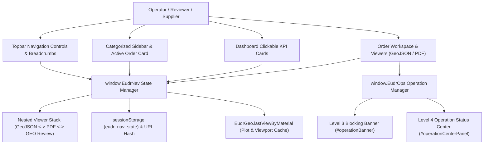

# P2 Architecture — UX, Navigation & Operation Experience Upgrade

## 1. Architectural Overview

The P2 upgrade introduces four modular frontend subsystems inside the existing KODA EUDR Workspace without altering backend API contracts or P0/P1 Supplier Identity services:

1. **`window.EudrNav` (Context-Aware Navigation State Manager)** — Centralized history, forward stack, nested viewer stack, order context cache, URL hash deep-link synchronization, and unsaved-form navigation guard.
2. **Categorized & Collapsible Sidebar Chrome** — Role-filtered 3-tier navigation hierarchy (`OPERATIONS`, `EUDR MANAGEMENT`, `ADMINISTRATION`), desktop collapse toggle (`#sidebarCollapseBtn`), mobile drawer (`#mobileMenuBtn`), and active/recent order quick-return card (`#sidebarOrderContext`).
3. **Unit-Consistent Actionable Dashboard (`computeDashboardMetrics`)** — Role-scoped KPI computation separating orders, required evidence tasks, and active files, with 6 clickable KPI cards that drill into pre-filtered `Orders` or `My Tasks` views and provide a `← Back to Dashboard` return path.
4. **`window.EudrOps` (Global Loading & Operation Status Center)** — 4-level loading/operation state machine (`IDLE`, `QUEUED`, `RUNNING`, `SUCCEEDED`, `FAILED`, `OUTCOME_UNKNOWN`, `CANCELLED`) with real chunk progress, duplicate-submission prevention, and explicit `OUTCOME_UNKNOWN` recovery on write timeouts.

## 2. Component Interaction Diagram

## 3. Strict CSP & Resource Cleanup Compliance

- **Zero Inline Styles**: All visual states use CSS classes and `hidden` attributes in `public/style.css` (`style-src 'self'`).
- **Deterministic Cleanup**: Switching or closing viewers invokes `clearDocumentPreview()`, which calls `EudrGeo.close()` (removing the Leaflet map instance after saving `recordIndex`, `center`, and `zoom`), `pdfPreviewAbort.abort()`, `pdfPreviewCleanup()`, and `URL.revokeObjectURL()`.
