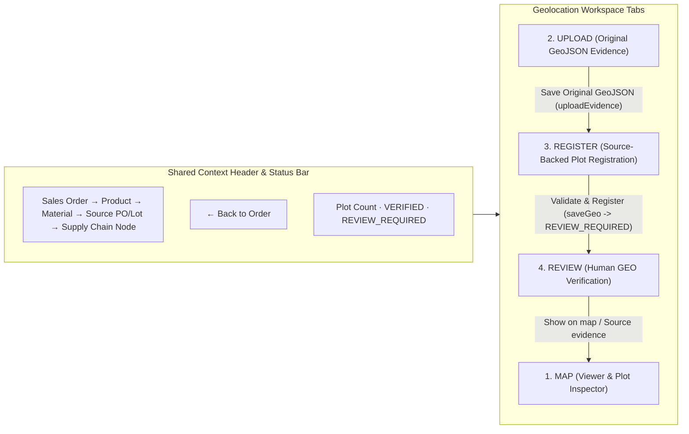

# KODA EUDR WORKSPACE — P2-E ARCHITECTURE
## Integrated 4-Tab Geolocation Workspace & Traceability Architecture

---

## 1. Architectural Overview

P2-E upgrades `window.EudrGeo` ([public/geo.js](file:///C:/Users/ADMIN/.gemini/antigravity/scratch/kodaeudrsystem/public/geo.js) and [public/geo.css](file:///C:/Users/ADMIN/.gemini/antigravity/scratch/kodaeudrsystem/public/geo.css)) into a structured, four-tab **Geolocation Workspace** that preserves all existing DOM IDs and server validation rules while providing clear separation of concerns across the four operational stages of EUDR plot management:

---

## 2. Component Architecture

### 2.1 Context Header (`#geoContextBar`)
- Renders verified context from live application state (`state.cases`, `state.products`, `state.materials`, `state.trace.sources`, `state.chain`):
  - `data-geo-context="order"`: Active Sales Order (`SO`)
  - `data-geo-context="product"`: Active Product (`product_name` or `All order products`)
  - `data-geo-context="material"`: Active Material (`material`)
  - `data-geo-context="source"`: Active Source PO / Lot (`supplier_po · Line · Lot` or `All material sources`)
  - `data-geo-context="node"`: Active Supply Chain Relationship (`display_name` / `plot_id` or `All relationships`)
- Never fabricates or infers missing values.

### 2.2 Tab State & DOM Persistence
- All four tab panels (`#geoTabPanel-map`, `#geoTabPanel-upload`, `#geoTabPanel-register`, `#geoTabPanel-review`) remain mounted in the DOM and toggle visibility strictly via the HTML `hidden` attribute (`.geo-workspace [hidden] { display: none !important }`), complying 100% with `style-src 'self'` CSP.
- Switching tabs preserves:
  - Selected local GeoJSON file (`selectedFile`), parsed features (`features`), and selected feature index (`#geoFeature`).
  - Partially completed registration form values (`#geoForm`) and dirty-form navigation guard (`EudrNav.markDirty(true)`).
  - Selected registered plot (`activeRecordIndex`, `selectedPlotId`) and Leaflet map viewport (`center`, `zoom`) in `lastViewByMaterial`.
- Switching back to `MAP` triggers `map.invalidateSize()` so Leaflet recalculates container bounds cleanly.

### 2.3 Integration with P2-A (`EudrNav`) & P2-D (`EudrOps`)
- **P2-A Navigation (`window.EudrNav`)**:
  - Opening a source document (`[data-geo-document]`) saves the active tab, selected plot index/ID, and map `center`/`zoom` in `lastViewByMaterial`, then pushes the `document` viewer onto `EudrNav`'s `viewerStack`.
  - Pressing `Back` (`EudrNav.back()` or `#drawerBackBtn`) pops the PDF viewer and restores the exact selected plot, tab, and map viewport in `Geolocation Workspace`.
  - Pressing `← Back to Order` (`#geoBackToOrder`) or `Back` again restores the exact `Order → Product → Material → Source PO/Lot → Supply Chain Node` in the Order Workspace.
  - Editing `#geoForm` or selecting a local file in `#geoFile` marks the form dirty (`EudrNav.markDirty(true)`), prompting for confirmation before discarding unsaved registration work.
- **P2-D Operation Status (`window.EudrOps`)**:
  - Wraps `uploadEvidence` (`addScopedRequirement` + `uploadEvidence`), `saveGeo` (+ optional `linkSourceRecord`), `reviewGeo`, and `exportGeoJSON` with `EudrOps.start`, `EudrOps.update`, `EudrOps.succeed`, `EudrOps.fail`, and `EudrOps.lockButton`.
  - Enforces single-flight execution (`busy` lock + `aria-busy="true"` button lock) to prevent duplicate uploads or registrations.
  - Maps HTTP `>= 500`, `UPSTREAM_TIMEOUT`, and `NETWORK_ERROR` to `OUTCOME_UNKNOWN` while keeping form inputs intact.
