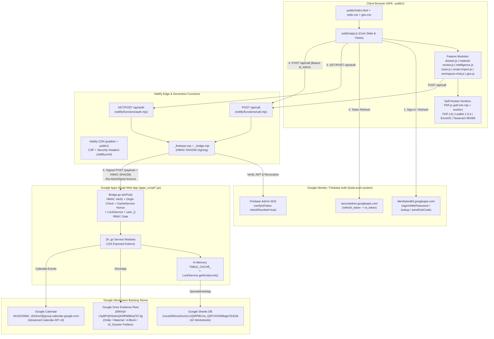
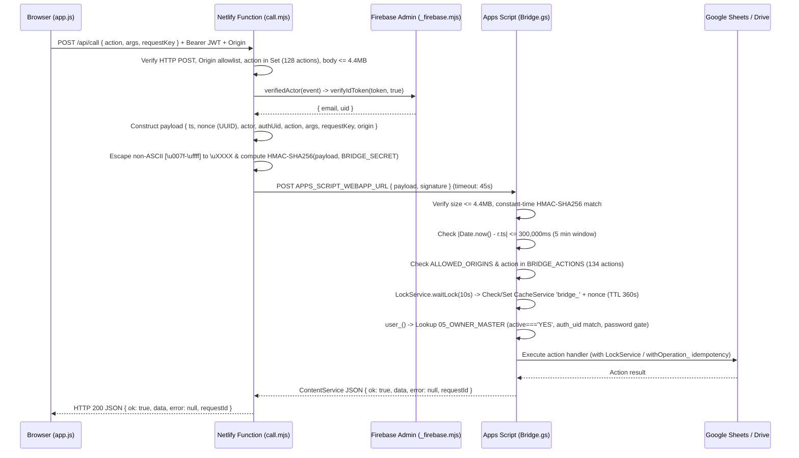
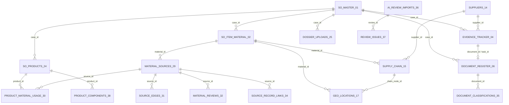

# 01 — ARCHITECTURE MAP (VERIFIED AS-IS IMPLEMENTATION)

- **Project:** KODA EUDR Workspace (`v2.9.4`)
- **Audit Phase:** Phase 0 (Read-Only System Audit — Gate A Deliverable 2 of 7)
- **Audit Timestamp:** 2026-10-16 (Asia/Ho_Chi_Minh)

---

## 1. End-to-End System Topology

The KODA EUDR Workspace operates as a serverless, zero-database-server multi-tier web application hosted on **Netlify** (static SPA + Serverless Functions), authenticated via **Firebase Authentication**, and backed by **Google Apps Script** acting as a signed RPC gateway over **Google Sheets** (42 worksheets), **Google Drive** (evidence & dossier file storage), and **Google Calendar** (deadline follow-up).



---

## 2. Authentication, Request Signing & Authorization Flow

### 2.1 Authentication Sequence
1. **Bootstrap Auth Config (`GET /api/auth`)**:
   - Browser calls `GET /api/auth` (`public/app.js:4` -> `netlify/functions/auth.mjs:8`).
   - Returns `{ ok: true, apiKey: FIREBASE_WEB_API_KEY, projectId: "koda-eudr-system", enabled: true }`.
2. **User Sign-In (`firebaseRequest`)**:
   - Browser sends email & password to `https://identitytoolkit.googleapis.com/v1/accounts:signInWithPassword?key=...` (`public/app.js:24`).
   - Stores `eudr_id_token`, `eudr_refresh_token`, and `eudr_token_expires` in `sessionStorage` (`public/app.js:7`).
   - Calls `accounts:lookup` to verify `user.emailVerified === true`. If unverified, blocks workspace entry and renders the email verification screen (`public/app.js:28-36`).
   - Calls `call('recordLogin')` followed by `call('bootstrap')`.
3. **Server-Side Token Verification (`netlify/functions/_firebase.mjs`)**:
   - Every `POST /api/call` and `POST /api/auth` extracts `Authorization: Bearer <token>`.
   - `verifyActorToken()` calls Firebase Admin SDK `auth.verifyIdToken(token, true)` (enforcing signature, project ID `koda-eudr-system`, expiration, disabled-account check, and token revocation check) plus `decoded.email_verified === true`.
   - Extracts `{ email: decoded.email.trim().toLowerCase(), uid: decoded.uid }`.
   - Legacy fallback (`LEGACY_TOKEN_LOGIN === 'true'`) is gated behind environment configuration (`netlify/functions/call.mjs:21-27`).

### 2.2 Bridge Signing & Replay Protection (`Netlify -> Apps Script`)



### 2.3 Role-Based Access Control (RBAC) & Server-Side Capabilities
Defined in `apps_script/AuthService.gs` (`lines 1, 78–88`):
- **9 Recognized Roles (`ROLES_`)**:
  `ADMIN`, `MARKETING`, `EUDR_REVIEWER`, `MP`, `PURCHASING`, `SOURCING`, `SUPPLIER_USER`, `INTERNAL_USER`, `VIEWER`.
- **14 Server-Side Capabilities (`CAPABILITIES_`)**:

| Role | Default Server-Side Capabilities (`AuthService.gs:80-81`) | Scope & Isolation Rules (`AuthService.gs:5-12, 83-90`) |
| :--- | :--- | :--- |
| **`ADMIN`** | All 14 capabilities (`ORDER_EDIT`, `SO_VIEW`, `MATERIAL_EDIT`, `SUPPLIER_EDIT`, `CHAIN_EDIT`, `EVIDENCE_UPLOAD`, `EVIDENCE_REVIEW`, `POLICY_EDIT`, `AI_USE`, `AI_REVIEW`, `GEO_EDIT`, `GEO_REVIEW`, `EXPORT`, `WORKFLOW_CLOSE`) | Full access across all orders, users, settings, and regulatory rules. |
| **`MARKETING`** | `ORDER_EDIT`, `SO_VIEW`, `EVIDENCE_REVIEW`, `POLICY_EDIT`, `AI_USE`, `AI_REVIEW`, `GEO_REVIEW`, `EXPORT`, `WORKFLOW_CLOSE` | Orders owned by user, assigned via `assigned_orders`, or where user owns/reviews a task. Only `ADMIN` and `MARKETING` can hold `SO_VIEW` (Sales Order commercial documents). |
| **`EUDR_REVIEWER`** | `EVIDENCE_REVIEW`, `POLICY_EDIT`, `GEO_REVIEW`, `AI_USE`, `AI_REVIEW`, `EXPORT` | Assigned orders/tasks; cannot view raw customer Sales Order PDF unless `SO_VIEW` granted (note: `grantCapabilities` blocks granting `SO_VIEW` to non-Marketing/Admin roles). |
| **`MP`** | `MATERIAL_EDIT`, `AI_USE` | Material Planning: defines materials, categories, and PO mappings on accessible orders. |
| **`PURCHASING`** | `SUPPLIER_EDIT`, `CHAIN_EDIT`, `EVIDENCE_UPLOAD`, `GEO_EDIT`, `AI_USE` | Manages suppliers, supply chain nodes, and uploads commercial/legality evidence. |
| **`SOURCING`** | `SUPPLIER_EDIT`, `CHAIN_EDIT`, `EVIDENCE_UPLOAD`, `GEO_EDIT`, `AI_USE` | Manages upstream supply chain nodes, plots, and geolocation (`GEO_EDIT`). |
| **`SUPPLIER_USER`** | `EVIDENCE_UPLOAD`, `GEO_EDIT` (Extra capability overrides explicitly blocked on line 84) | Strictly isolated to tasks/documents/nodes/geo matching `u.supplier_id`. Cannot see Drive folder IDs, internal review comments, uploader/reviewer emails, AI tabs, or other suppliers. |
| **`INTERNAL_USER`** | `[]` (plus any explicit `capabilities` JSON array granted by Admin, excluding `SO_VIEW`) | Task/order-scoped internal contributor. |
| **`VIEWER`** | `[]` (`requireWrite_` blocks all mutations) | Read-only access to assigned orders/tasks. |

---

## 3. Backend Service Architecture (`apps_script/*.gs`)

The Google Apps Script project consists of **26 `.gs` files** in `apps_script/` exposing **134 actions** in `Bridge.gs` (`128` via `POST /api/call` and `6` via `POST /api/auth`).

| # | Service File (`apps_script/`) | Size (Bytes) | Functions | Primary Responsibilities & Exposed Bridge Actions |
| :--- | :--- | :---: | :---: | :--- |
| 1 | `Code.gs` | 8,899 | 17 | Base `SCHEMA` (tabs 01–11), `PREPARED` IDs, `db_()`, `rows_()`, `add_()`, `patch_()`, `delete_()`, `user_()`, `lock_()`, `audit_()`, `config_()`. |
| 2 | `Bridge.gs` | 5,170 | 3 | `doPost(e)` gateway, `BRIDGE_ACTIONS` registry (134 actions), HMAC-SHA256 verification, origin check, `CacheService` nonce replay guard. |
| 3 | `Migration.gs` | 16,053 | 7 | Additive schema definitions and editor-only migrations `migrateV2`, `migrateV21`, `migrateV22`, `migrateV23`, `migrateV24`, `migrateV2414` (tabs 14–24). |
| 4 | `V290Migration.gs` | 6,297 | 4 | Editor-only `previewV290Migration`, `applyV290Migration` and schema registration for tabs `35_DOCUMENT_CLASSIFICATIONS` through `43_REGULATION_RULES`. |
| 5 | `AuthService.gs` | 16,749 | 26 | RBAC (`requireRole_`, `requireCapability_`), `manageUser`, `prepareRemoveUser`, `removeUser`, `grantCapabilities`, `listSuppliers`, `manageSupplier`, `removeSupplier`, `saveSettings`, `recordLogin`, and 6 Firebase `/api/auth` callbacks (`authState`, `authPasswordChanged`, `authProvisionCheck`, `authProvisioned`, `authAccountStateCheck`, `authAccountStateRecorded`). |
| 6 | `WorkspaceService.gs` | 10,566 | 7 | `bootstrap` (loads 19 tables), `getMaterialReadiness`, `getDossierReview`, `completeCase`, `reopenCase`. |
| 7 | `OrderService.gs` | 36,021 | 40 | Idempotency wrapper `withOperation_()` (`21_OPERATIONS`), `createOrder`, `updateOrder`, `findOrderFolders`, `listOrderProducts`, `saveOrderProduct`, `removeOrderProduct`, `uploadProductImage`, `createMaterial`, `updateMaterial`, `removeMaterial`, `previewMaterials`, `confirmMaterials`, `addChainNode`, `updateChainNode`, `removeChainNode`, `updateEvidenceRequirement`, `setTaskRequirement`, `addScopedRequirement`, `removeScopedRequirement`, `updateTask`, `markNotification`. |
| 8 | `DocumentService.gs` | 19,681 | 12 | `uploadEvidence`, `removeDraftEvidence`, `submitDocument`, `reviewDocument`, `getDocument`, `addComment`, `uploadProcessed`, `registerExternalAiOutput`, `verifyProcessed`, `repairExistingSOReviewTask`. |
| 9 | `TransferService.gs` | 6,324 | 6 | Chunked upload/download for files 2–3 MB (`beginUpload`, `uploadChunk`, `finishUpload`, `getDocumentChunk`) using `23_UPLOAD_SESSIONS` and `CacheService`. |
| 10 | `GeoService.gs` | 7,540 | 5 | Geometry validation (`Point` / single-ring `Polygon`, 6–12 decimal digits, `>4 ha` polygon rule, self-intersection check), `saveGeo`, `reviewGeo`, `exportGeoJSON`, `chainIssues_`. |
| 11 | `CalendarService.gs` | 6,462 | 4 | Advanced Calendar API v3 integration (`syncTaskCalendar_`, `syncCalendar`, `calendarInvitees_`, `calendarPatch_`). |
| 12 | `MetadataService.gs` | 7,278 | 4 | `updateMaterialInfo`, `saveCertificate`, `saveCountryRisk`, `materialIssues_` (validates scientific species, production country, harvest range, country risk, legality/deforestation evidence). |
| 13 | `PromptService.gs` | 27,754 | 12 | Legacy/Order-level Prompt Studio (`getAiPrompt`, `importAiResult`, `syncAIOutputs`, `getAIOutputs`, `reviewAIResult`). |
| 14 | `ExportService.gs` | 10,208 | 6 | `exportPackage`, `exportPackages` (builds approved Evidence ZIP & JSON manifest in Drive, logs to `19_EXPORT_LOG`, excludes orphaned/superseded files). |
| 15 | `DossierService.gs` | 40,417 | 22 | Multi-part PDF dossier upload & splitting (`beginDossierUpload`, `relayDossierChunk`, `resumeDossierUpload`, `getDossierUploadStatus`, `finishDossierUpload`, `mapDossierPart`, `getDossierPrompt`, `importDossierResult`, `syncDossierResults`, `getDossierHub`, `migrateV25`). |
| 16 | `SmartImportService.gs` | 17,547 | 11 | Smart SO/PO/Excel order import (`createImportDraft`, `previewOrderImport`, `confirmOrderImport`, `getSmartImportState`, `getImportPreview`, `migrateV26`). |
| 17 | `AIService.gs` | 19,664 | 12 | Optional automated OpenAI API job queue (`getAIConfig`, `queueAIJob`, `getAIJob`, `cancelAIJob`, `listAIJobs`, `processAIJobs`). |
| 18 | `TraceService.gs` | 25,352 | 25 | Product-Material-PO/Lot graph (`getTraceWorkspace`, `saveMaterialSource`, `prepareMaterialReviewSource`, `saveProductMaterialUsage`, `deactivateProductMaterialUsage`, `saveSourceEdge`, `deactivateSourceEdge`, `linkSourceRecord`, `previewMaterialRemoval`, `applyMaterialRemoval`, `migrateV27`). |
| 19 | `MaterialReviewService.gs` | 44,022 | 20 | Material/PO/Lot Dossier AI Review & Chain Proposal (`createMaterialReview`, `getMaterialReviews`, `getMaterialReviewPrompt`, `refreshMaterialReviews`, `applyMaterialReviewActions`, `mapMaterialSourceDocument`, `applyMaterialChainProposal`). |
| 20 | `WorkspaceChatService.gs` | 15,335 | 15 | Material OCR index & Q&A (`getWorkspaceChatIndex`, `saveWorkspaceChatIndex`, `askWorkspaceChat`, `getWorkspaceChatAnswer`, `listWorkspaceChatJobs`). |
| 21 | `IntelligenceService.gs` | 12,726 | 8 | Order-level KODA Workspace Q&A (`askKodaWorkspace`, `getKodaWorkspaceHistory`). |
| 22 | `ReviewBridgeService.gs` | 24,321 | 14 | KODA Business Review Pack (`prepareKodaBusinessReview`, `getKodaBusinessReviewPack`, `prepareKodaBusinessReviewDelivery`, `syncKodaBusinessReviewResults`, `importKodaBusinessReview`, `getKodaReviewDashboard`). |
| 23 | `ClassificationService.gs` | 14,261 | 4 | Document page-range classification & real child PDF splitting (`previewKodaDocumentClassification`, `saveKodaDocumentClassification`). |
| 24 | `IssueService.gs` | 7,496 | 4 | Review issue tracker (`createKodaReviewIssue`, `updateKodaReviewIssue`, `refreshKodaReviewScope`). |
| 25 | `CustomerSubmissionService.gs` | 27,905 | 10 | La Redoute & customer submission readiness (`getKodaCustomerWorkspace`, `saveKodaProductComponent`, `saveKodaCustomerMapping`, `checkKodaCustomerReadiness`, `prepareKodaCustomerSubmission`, `updateKodaCustomerSubmission`, `exportKodaCustomerSubmission`). |
| 26 | `IntelligencePolicyService.gs` | 2,591 | 2 | Regulatory & customer field mapping rules (`saveKodaRegulationRule`, `saveKodaCustomerFieldMapping`). |

---

## 4. Relational Data Model Across 42 Google Sheets Tabs



### Complete 42-Worksheet Inventory (Verified Live Workbook `1xura5W6coeGeJsc1zQMP6Emw_QMTv5XAf0bqpC5Uk3A`)

| # | Worksheet Name | Live Data Rows | Primary Key | Foreign Keys / Scope | Purpose |
| :-: | :--- | :-: | :--- | :--- | :--- |
| 1 | `01_SO_MASTER` | 3 | `id` | `so_document_id`, `product_image_id` | Master Sales Orders (`SO25-2183`, `SO25-1863`, `SO26-1619`). |
| 2 | `02_SO_ITEM_MATERIAL` | 9 | `id` | `case_id`, `supplier_id`, `product_ids` | Wood/derived materials per Sales Order. |
| 3 | `03_EVIDENCE_REQUIREMENT` | 10 | `id` | `policy_id` | Default evidence requirement templates (`R0`–`R9`). |
| 4 | `04_EVIDENCE_TRACKER` | 105 | `id` | `case_id`, `material_id`, `chain_node_id`, `supplier_id`, `document_id`, `source_id` | Required/optional evidence tasks per order/material/node. |
| 5 | `05_OWNER_MASTER` | 8 | `email` | `supplier_id`, `auth_uid` | Authorized users, roles, capabilities, Firebase UID binding. |
| 6 | `06_DOCUMENT_REGISTER` | 22 | `id` | `case_id`, `task_id`, `material_id`, `supplier_id`, `chain_node_id`, `source_document_id` | Immutable versioned registry of uploaded & derived files in Drive. |
| 7 | `07_AI_REVIEW_QUEUE` | 0 | `id` | `case_id`, `document_id`, `material_id`, `prompt_run_id` | Legacy order-level AI review findings queue. |
| 8 | `08_ACTIVITY_LOG` | 129 | `id` | `case_id`, `entity_id`, `actor` | Append-only audit log of all mutations and sign-ins. |
| 9 | `09_CONFIG` | 16 | `key` | — | System configuration, Drive/Calendar IDs, legal review state. |
| 10 | `10_INTEGRATION_LOG` | 0 | `batch_id` | — | ERP/external integration batch log. |
| 11 | `11_INTEGRATION_ERROR` | 0 | `batch_id` | `source_key` | Integration error queue. |
| 12 | `12_AI_ASSISTANT` | 9 | — | — | Sheet documentation/instructions tab. |
| 13 | `13_PILOT_REVIEW` | 12 | `CHECK` | — | Pilot assessment notes (Hartzell Hardwoods `PO-25-06780`). |
| 14 | `14_SUPPLIERS` | 13 | `id` | `supplier_code` | Master supplier directory. |
| 15 | `15_SUPPLY_CHAIN` | 9 | `id` | `case_id`, `material_id`, `supplier_id`, `parent_id`, `source_document_id` | Supply chain relationship tree per material. |
| 16 | `16_COMMENTS` | 0 | `id` | `case_id`, `document_id` | Document review comments (`SHARED_WITH_SUPPLIER` / `INTERNAL_ONLY`). |
| 17 | `17_GEO_LOCATIONS` | 0 | `id` | `case_id`, `material_id`, `chain_node_id`, `source_document_id`, `source_id` | Registered plot points/polygons and verification status. |
| 18 | `18_AI_PROMPT_RUNS` | 0 | `id` | `case_id`, `document_id` | Legacy Prompt Studio execution runs. |
| 19 | `19_EXPORT_LOG` | 0 | `id` | `case_id`, `file_id` | Audit log of generated EUDR evidence export ZIP packages. |
| 20 | `20_NOTIFICATIONS` | 2 | `id` | `email`, `case_id`, `object_id` | In-app user notifications. |
| 21 | `21_OPERATIONS` | 41 | `id` | `actor`, `fingerprint` | Idempotency ledger preventing duplicate mutation execution. |
| 22 | `22_COUNTRY_RISK` | 0 | `id` | `country_code`, `rule_version` | Country risk benchmarking records (`LOW`, `STANDARD`, `HIGH`). |
| 23 | `23_UPLOAD_SESSIONS` | 0 | `id` | `case_id`, `task_id`, `document_id` | Chunked upload state tracker. |
| 24 | `24_SO_PRODUCTS` | 4 | `id` | `case_id`, `image_document_id`, `import_source_document_id` | Products belonging to a Sales Order. |
| 25 | `25_DOSSIER_UPLOADS` | 19 | `id` | `case_id`, `document_id`, `source_document_id`, `material_id`, `source_id` | Multi-PDF dossier uploads and split child PDF records. |
| 26 | `26_DOSSIER_CHECKS` | 0 | `id` | `case_id`, `document_id`, `prompt_run_id` | Whole-order dossier AI check results. |
| 27 | `27_IMPORT_PREVIEWS` | 4 | `id` | `case_id`, `source_document_id` | Smart Import parsed order/product/material previews. |
| 28 | `28_AI_JOBS` | 0 | `id` | `case_id`, `source_document_id`, `prompt_run_id` | Background/queued OpenAI API job records. |
| 29 | `29_MATERIAL_SOURCES` | 5 | `id` | `case_id`, `material_id`, `supplier_id` | PO / PO line / Lot / batch sources for a material. |
| 30 | `30_PRODUCT_MATERIAL_USAGE` | 0 | `id` | `case_id`, `product_id`, `material_id`, `source_id` | Many-to-many allocation linking Products, Materials, and PO/Lot Sources. |
| 31 | `31_SOURCE_EDGES` | 8 | `id` | `case_id`, `material_id`, `source_id`, `from_node_id`, `to_node_id` | Directed edges in the PO/lot supply chain graph. |
| 32 | `32_MATERIAL_REVIEWS` | 8 | `id` | `case_id`, `material_id`, `source_id`, `result_file_id` | Material/PO/Lot AI Dossier review runs and Drive result links. |
| 33 | `34_SOURCE_RECORD_LINKS` | 1 | `id` | `case_id`, `material_id`, `source_id`, `record_id` | Scoped links tying Tasks, Documents, or Geo records to a specific PO/Lot Source. |
| 34 | `35_DOCUMENT_CLASSIFICATIONS` | 0 | `id` | `case_id`, `document_id` | Page-range document classification & split manifests. |
| 35 | `36_AI_REVIEW_IMPORTS` | 1 | `id` | `case_id`, `material_id`, `source_id`, `product_id` | Imported v2.9 KODA Business Review packs. |
| 36 | `37_REVIEW_ISSUES` | 0 | `id` | `finding_id`, `review_id`, `case_id`, `material_id`, `task_id` | Actionable compliance/evidence issues raised from reviews. |
| 37 | `38_PRODUCT_COMPONENTS` | 0 | `id` | `case_id`, `product_id` | Product Bill-of-Materials (BOM) wood components & weights. |
| 38 | `39_CUSTOMER_PO_MAPPING` | 0 | `id` | `case_id`, `product_id` | Customer-specific (e.g. La Redoute) PO & entity mappings. |
| 39 | `40_CUSTOMER_FIELD_MAPPING` | 0 | `id` | `customer`, `source_field`, `target_field` | Customer portal field transformation & validation rules. |
| 40 | `41_CUSTOMER_SUBMISSIONS` | 0 | `id` | `case_id`, `package_id` | Customer compliance submission packages & approval states. |
| 41 | `42_AI_CHAT_HISTORY` | 0 | `id` | `case_id`, `material_id`, `source_id`, `product_id` | Audited workspace AI Q&A history. |
| 42 | `43_REGULATION_RULES` | 0 | `id` | `rule_version`, `category` | Versioned regulatory, customer, and internal policy rules. |

---

## 5. Google Drive Evidence Folder Architecture

Verified against `apps_script/OrderService.gs`, `DocumentService.gs`, `DossierService.gs`, and live Drive inspection of `DRIVE_ROOT_FOLDER_ID` (`1BWXpf-L6yBPQtXbskoQKMfN890aZXCJg` — `EUDR SYSTEM`):

```text
EUDR SYSTEM (1BWXpf-L6yBPQtXbskoQKMfN890aZXCJg)
├── SO25-2183 [ac40a9f0df1da2c40ebc02bfb4d454c6] (1ornpuP5UNryAqlz2SAKTZLnYkbR4Bp-c)
│   ├── 00_Sales_Order/
│   ├── AI_Dossier/ (1736LnCTSAMhZ-4QvnFosPKkUnrAM9PVn)
│   ├── AI_Outputs/
│   ├── Exports/
│   └── <Material Folder> [material_id]/
│       └── <Relationship Folder> [chain_node_id]/
│           ├── 01_Commercial_Shipping/
│           ├── 02_Certifications_Chain_of_Custody/
│           ├── 03_Legality_Compliance/
│           └── 04_Geolocation/
├── SO25-1863 [e33a494fbd75ec572b77a6b73f2cd857] (1cf9G4W37bnE82PhioM49Lqoj7bqHguJR)
└── SO26-1619 [2352c891a5dae4bdd543d98c9a2db8f7] (1xkzyk9QvINNt_x7-VMf0ADKQplfwHsBq)
```

---

## 6. Critical Business Rules Enforced in Code

1. **Human-Controlled Governance (`WorkspaceService.gs:9-18`, `GeoService.gs:25-29`, `DocumentService.gs:29-42`)**:
   - No AI output (`07_AI_REVIEW_QUEUE`, `26_DOSSIER_CHECKS`, `32_MATERIAL_REVIEWS`, `36_AI_REVIEW_IMPORTS`, `42_AI_CHAT_HISTORY`) can ever set a task, document, geo plot, or order to `APPROVED`, `VERIFIED`, or `CLOSED`.
   - `completeCase` requires `input.confirmed === true`, non-empty human comment, `RULES_CONFIRMED === 'YES'`, `!legalState_().reviewDue`, all required tasks `APPROVED`, zero material issues, zero unreviewed AI findings, and an approved export package (`19_EXPORT_LOG`).
2. **Plot Geolocation Rules (`GeoService.gs:1-24`)**:
   - Coordinate precision must be explicitly declared between `6` and `12` decimal places (`GEO_MIN_DECIMALS = 6`).
   - Plots with `area_ha > 4` (`GEO_POLYGON_THRESHOLD_HA = 4`) reject `Point` geometry and require a closed, non-self-intersecting single-ring `Polygon` (`4–2000` vertices).
   - `LineString` in GeoJSON is preview-only unless the human operator explicitly checks the confirmation box to convert a closed `LineString` boundary into a `Polygon` (`public/geo.js`).
3. **Supplier Isolation (`AuthService.gs:5-12, 83-90`, `WorkspaceService.gs:1-7`)**:
   - `SUPPLIER_USER` accounts only receive tasks, documents, supply-chain nodes, and geo records matching their `supplier_id`, with Drive `file_id`, `folder`, `review_comment`, `uploaded_by`, and `reviewed_by` stripped server-side.
4. **Sales Order Commercial Confidentiality (`AuthService.gs:85, 89-90`)**:
   - Only `ADMIN` and `MARKETING` roles possess `SO_VIEW`. Any document derived from a Sales Order (`salesOrderDerived_(d)`) is hidden from all other roles server-side.
