# 05 — MASTER IMPLEMENTATION PLAN (PHASES 1–7)

- **Project:** KODA EUDR Workspace (`v2.9.4` → Enterprise Upgrade)
- **Audit Phase:** Phase 0 (Read-Only System Audit — Gate A Deliverable 6 of 7)
- **Audit Timestamp:** 2026-10-16 (Asia/Ho_Chi_Minh)
- **Execution Gate Status:** **AWAITING GATE A OWNER APPROVAL** (Zero code changes applied yet)

---

## 1. Guiding Principles & Architectural Constraints

1. **Preserve Working Functionality (100% Backward Compatibility)**:
   - All 134 existing `Bridge.gs` actions, all 42 Google Sheets tabs and column positions, all Google Drive folder hierarchies (`00_Sales_Order`, `01`–`04` evidence blocks, `AI_Dossier`, `AI_Outputs`, `Exports`), all Firebase UID bindings, and all existing DOM hooks (`data-action`, `data-view`, `data-order-tab`, `id`) used by companion modules and tests are preserved.
2. **Zero Destructive Schema Changes**:
   - The live workbook (`SCHEMA_VERSION = 2.9.2000`) already contains all 42 worksheets (`01_SO_MASTER` through `43_REGULATION_RULES`). No worksheet tab or column will be deleted, renamed, or reordered.
3. **Strict CSP & Zero Inline Styles**:
   - Maintain `script-src 'self' 'wasm-unsafe-eval'; style-src 'self'` in `netlify.toml`. Never inject inline `style="..."` attributes into DOM elements (preserving `tests/upstream-and-preview.test.mjs` compliance).
4. **English Default UI + Complete Vietnamese Option (`EN` / `VI`)**:
   - Keep English (`en`) as the default language (`<html lang="en">`), remove hardcoded Vietnamese strings from English templates (`AUD-014`), and maintain 100% Vietnamese (`vi`) translation coverage in `public/i18n.js`.

---

## 2. Phased Implementation Roadmap (Workstreams A–F)

```mermaid
flowchart LR
  P0["Phase 0: Read-Only Audit\n(COMPLETED - Gate A)"] --> P1["Phase 1: Workstream A\nPerformance, Stability & Test Harness"]
  P1 --> P2["Phase 2: Workstream B & C\nEnterprise UX/UI & Lucian Micro-Interactions"]
  P2 --> P3["Phase 3: Workstream D\nEvidence, PDF Viewer & Split Studio"]
  P3 --> P4["Phase 4: Workstream E\nRegulatory Control Center (3-Layer)"]
  P4 --> P5["Phase 5: Workstream F\nGoogle Calendar Follow-Up & Sync"]
  P5 --> P6["Phase 6: Full Regression,\nA11y & Staging Verification (Gate B)"]
  P6 --> P7["Phase 7: Production Release\n& Post-Deploy Audit (Gate C)"]
```

---

### PHASE 1 — WORKSTREAM A: Performance, Stability, Bridge Hardening & Test Suite Restoration

**Objective:** Eliminate `UPSTREAM_NON_JSON` / `UPSTREAM_TIMEOUT` root causes, fix the `_bridge.mjs` Unicode HMAC bug, restore 100% test execution in `tests/runtime.mjs`, cut Apps Script Sheets RPC volume by >90%, and add client-side document caching.

| Step | Target File(s) | Exact Engineering Change | Findings Addressed |
| :-: | :--- | :--- | :--- |
| `1.1` | `tests/runtime.mjs`, `package.json` | Load all 26 `.gs` files in `tests/runtime.mjs` (`V290Migration.gs`, `WorkspaceChatService.gs`, `IntelligencePolicyService.gs`, `IntelligenceService.gs`, `ReviewBridgeService.gs`, `ClassificationService.gs`, `IssueService.gs`, `CustomerSubmissionService.gs` before `Bridge.gs`). Update `npm run check` to check all JS/MJS files in `public/` and `netlify/functions/`. | `AUD-007` |
| `1.2` | `netlify/functions/_bridge.mjs`, `netlify/functions/call.mjs` | Add `.replace(/[\u007f-\uffff]/g, c => '\\u' + c.charCodeAt(0).toString(16).padStart(4, '0'))` in `_bridge.mjs:5` for 100% HMAC parity with `call.mjs`. Enhance `call.mjs` upstream non-JSON diagnostic logging and safe error classification. | `AUD-002`, `AUD-003`, `SEC-003` |
| `1.3` | `apps_script/Bridge.gs` | Guard `BRIDGE_ACTIONS` lookup inside `doPost` `try/catch` so a missing function never crashes V8 at top-level load time with an HTML error page. | `AUD-002` |
| `1.4` | `apps_script/Code.gs`, `apps_script/OrderService.gs` | 1. Memoize `SpreadsheetApp.openById(id)` and spreadsheet timezone per request (`DB_HANDLE_`, `DB_TZ_`) reset in `doPost`. 2. Make `lock_(fn)` re-entrant within the same request (`LOCK_DEPTH_`) so `withOperation_()` does not release/re-acquire `LockService` 3 times. 3. Upgrade `patch_(n, id, o)` to write updated row ranges in a single `setValues` call when multiple columns change and update `TABLE_CACHE_[n]` write-through. 4. Harden `safe_(v)` regex to `/^[\t\r\n ]*[=+@\-]/`. | `AUD-004`, `AUD-005`, `PERF-001`, `PERF-002`, `PERF-007`, `SEC-004` |
| `1.5` | `public/app.js`, `netlify.toml`, `public/eudr-workspace-icon.png` | 1. Add session-scoped LRU `DOCUMENT_CACHE` (`Map`, max 40 MB, cleared on `clearAuth()`) so `fileBytes()` and product image preview (`product.image_document_id`) never re-download already fetched documents. 2. Deduplicate in-flight `bootstrap` requests. 3. Scope `Cache-Control` in `netlify.toml` so `/vendor/*` is cached by browsers while `/` and `/api/*` remain `no-store`. 4. Optimize `public/eudr-workspace-icon.png` from `555 KB` to `<15 KB`. | `AUD-011`, `PERF-003`, `PERF-004`, `PERF-005`, `PERF-006` |
| `1.6` | Root repository cleanup (Isolated Branch) | Remove/archive the 168 duplicate `.bcmap` files, `standard_fonts/`, `wasm/`, `pdf.min.mjs`, `pdf.worker.min.mjs`, and stale root v2.2 `.gs`/`.js` copies from the working branch after verifying zero test/build references. | Section 2.2 Repo Hygiene |

---

### PHASE 2 — WORKSTREAMS B & C: Enterprise UX/UI & Lucian Micro-Interactions

**Objective:** Elevate visual hierarchy, scannability, responsive behavior (`360px` to `1440px+`), and bilingual consistency (`EN` default / `VI` option) using KODA brand identity (`#0B2923`, `#143C32`, `#267158`, `#D8E7A5`, `#F5F7F3`) and CSP-compliant Lucian micro-interactions.

| Step | Target File(s) | Exact Engineering Change | Findings Addressed |
| :-: | :--- | :--- | :--- |
| `2.1` | `public/style.css`, `public/index.html` | 1. Refine KODA Enterprise design tokens (typography scale, card elevation, status badges, sticky table headers, responsive grid breakpoints for `360px`, `768px`, `1024px`, `1440px`). 2. Implement 7 selected Lucian patterns in pure external CSS (`#040` Sliding Tab Indicator, `#042` Skeleton Shimmer, `#032` Interactive Step Progress, `#039` Accordion Smooth Expand, `#046` Sticky Toast/Status Banner for `#msg`, `#189` Live Metric Pulse, `#101` Sticky PDF Toolbar Dock) with full `@media (prefers-reduced-motion: reduce)` support. | `AUD-010`, Workstream B & C |
| `2.2` | `public/app.js` | 1. Preserve scroll position (`window.scrollY` / container scroll) when switching Products, Materials, PO/Lot sources, and Supply Chain nodes inside `workspace()`. 2. Add "Missing Metadata Checklist" banner in Order Workspace when an order lacks `customer`, `due`, or material `scientific_name` (with 1-click actions to `editOrder` / `materialInfo`). 3. Add instant search/filter bar to `Audit Trail` (`audit()`) and `My Tasks` (`myTasks()`). | `AUD-010`, `AUD-012` |
| `2.3` | `public/app.js`, `public/i18n.js` | Replace all hardcoded Vietnamese strings in `public/app.js` (lines 159, 160, 163) with English defaults wrapped in `tt(...)` and ensure complete `EN` ↔ `VI` translation parity in `public/i18n.js`. | `AUD-014` |

---

### PHASE 3 — WORKSTREAM D: Evidence & PDF Review Studio

**Objective:** Make reviewing multi-page supplier PDFs, verifying SHA-256/version lineage, and splitting combined dossiers into the 4 evidence blocks fast, ergonomic, and auditable.

| Step | Target File(s) | Exact Engineering Change | Findings Addressed |
| :-: | :--- | :--- | :--- |
| `3.1` | `public/pdf-preview.mjs`, `public/style.css` | Upgrade `renderPdfPreview` toolbar with: - Previous (`←`) / Next (`→`) buttons + keyboard arrow support - Direct **Page Jump input** (`Page [ 4 ] of 17`) - **Zoom controls** (`Zoom Out −`, `Fit Width`, `Zoom In +`, `50%–250%`) - External CSS classes only (strictly `0` inline `style` attributes, preserving `tests/upstream-and-preview.test.mjs`). | `AUD-009`, Workstream D |
| `3.2` | `public/app.js` (`documentView`) | Enhance Document Review Drawer header & metadata panel to display complete provenance: - Document ID, Version (`v1`, `v2`...), Active/Superseded badge - SHA-256 fingerprint (`metadata.sha256`), File Size (`metadata.file_size_bytes`), MIME type - Uploader (`metadata.uploaded_by`), Created/Submitted/Reviewed timestamps - Linked Order, Material, PO/Lot Source, Supply Chain Node, Evidence Block (`01`–`04`) - Parent Source Document link (`metadata.source_document_id`) for split/processed child PDFs. | `AUD-009`, Workstream D |
| `3.3` | `public/dossier.js`, `public/intelligence.js` (`classify` tab), `public/material-review.js` | Enhance PDF Split & Classification UI with: - Quick "Preview Page Range" button that opens/scrolls the PDF preview to the exact `start_page` of a proposed split section - Real-time page range overlap/gap indicator before clicking "Confirm & Split PDF" - Clear parent-to-child PDF lineage badges showing which child PDFs have already been generated and their current human review status (`UPLOADED`, `SUBMITTED`, `APPROVED`). | `AUD-009`, Workstream D |

---

### PHASE 4 — WORKSTREAM E: Regulatory Control Center (3-Layer Governance)

**Objective:** Upgrade the `Settings` screen into a comprehensive **Regulatory Control Center** separating EU Official Law (Layer 1), Customer Compliance Rules (Layer 2), and KODA Internal Operational Policy (Layer 3), enabling authorized Admins to review and confirm the legal baseline without auto-certifying compliance.

| Step | Target File(s) | Exact Engineering Change | Findings Addressed |
| :-: | :--- | :--- | :--- |
| `4.1` | `public/app.js` (`settings`), `public/i18n.js`, `public/style.css` | Build the 3-Layer **Regulatory Control Center** UI inside `settings()` (retaining all existing form field names for backward compatibility): 1. **Layer 1 — Official EU EUDR Legal Baseline (`09_CONFIG` + `43_REGULATION_RULES` category `LEGAL_REQUIREMENT`)**:    - Pre-fillable reference presets (requiring explicit Admin review & checkbox confirmation before saving via `saveSettings`):      - **Regulation (EU) 2023/1115** (Consolidated `2025-12-26`, ELI: `https://eur-lex.europa.eu/eli/reg/2023/1115/2025-12-26`)      - **Regulation (EU) 2025/2650** (OJ `2025-12-23`, amending application timeline to **30 Dec 2026** for large/medium operators and **30 Jun 2027** for micro/small enterprises, ELI: `https://eur-lex.europa.eu/eli/reg/2025/2650/oj`)      - **Delegated Regulation (EU) 2026/2102** (OJ `2026-09-17`, amending Annex I wood furniture HS codes: `9401` seats with wood, `ex 9403 30 00`, `ex 9403 40 00`, `ex 9403 50 00`, `ex 9403 60 00`, `9403 91 00` wooden furniture parts, `9406 10 00`, ELI: `https://eur-lex.europa.eu/eli/reg_del/2026/2102/oj`)      - **Implementing Regulation (EU) 2025/1093** (OJ `2025-05-22`, country risk benchmarking list, ELI: `https://eur-lex.europa.eu/eli/reg_impl/2025/1093/oj`)      - **Implementing Regulation (EU) 2026/1565** (Information System rules) & **Commission Notice C/2026/3896**.    - Displays `LAST_LEGAL_REVIEW_DATE`, `LEGAL_REVIEWED_BY`, days remaining until next 90-day review (`LEGAL_REVIEW_MAX_DAYS`), and `RULES_CONFIRMED` status. 2. **Layer 2 — Customer Compliance Rules (`43_REGULATION_RULES` category `CUSTOMER_REQUIREMENT` + `40_CUSTOMER_FIELD_MAPPING`)**:    - La Redoute & customer-specific requirement mapping form calling `saveKodaRegulationRule` and `saveKodaCustomerFieldMapping`. 3. **Layer 3 — KODA Internal Evidence Policy (`03_EVIDENCE_REQUIREMENT` + `43_REGULATION_RULES` category `KODA_INTERNAL_POLICY`)**:    - Direct link/panel to manage `03_EVIDENCE_REQUIREMENT` (`R0`–`R9`) and internal verification rules. 4. **Country Risk Benchmarking Directory (`22_COUNTRY_RISK`)**:    - Interactive table of registered `22_COUNTRY_RISK` records (`LOW`, `STANDARD`, `HIGH`) with quick-seed/review form calling `saveCountryRisk`. | `AUD-008`, Workstream E |
| `4.2` | `apps_script/WorkspaceService.gs`, `apps_script/AuthService.gs` | Include `regulationRules: supplier ? [] : rows_('43_REGULATION_RULES')` and `customerFieldMappings: supplier ? [] : rows_('40_CUSTOMER_FIELD_MAPPING')` in `bootstrap()` (or load on demand) and allow `saveSettings` to persist `CALENDAR_SYNC_ENABLED` and `REMINDERS_ENABLED` alongside legal review settings. | `AUD-008`, Workstream E & F |

---

### PHASE 5 — WORKSTREAM F: Google Calendar Follow-Up & Milestone Sync

**Objective:** Transform Google Calendar integration into a reliable, configurable (`MANUAL` / `AUTO`), spam-free deadline follow-up system covering evidence tasks, order deadlines, certificate expiries, and review issues.

| Step | Target File(s) | Exact Engineering Change | Findings Addressed |
| :-: | :--- | :--- | :--- |
| `5.1` | `apps_script/CalendarService.gs`, `apps_script/OrderService.gs` | 1. Respect `config_('CALENDAR_SYNC_ENABLED')` (`MANUAL` vs `AUTO`) and `config_('REMINDERS_ENABLED')` (`YES` vs `NO`) in `syncTaskCalendar_()`. 2. When `CALENDAR_SYNC_ENABLED === 'MANUAL'`, bulk task creation (`createOrder`, `confirmMaterials`, `syncNodeRequirements_`) sets `calendar_sync_status: t.due ? 'PENDING_SYNC' : 'NOT_SCHEDULED'` without firing 40+ synchronous Calendar API calls inside the order creation lock. 3. When `syncCalendar()` is explicitly triggered by the user (or when `CALENDAR_SYNC_ENABLED === 'AUTO'` on single-task `updateTask`), sync events to `GOOGLE_CALENDAR_ID` (`44c53155b661c93b06c6ee49bd9cce5764a91fa80cc57c805de639d3483cfce2@group.calendar.google.com`) with rich structured descriptions (Order No, Customer, Material, PO/Lot, Evidence Block, Assigned Owner/Reviewer, Priority, Status, and Workspace Deep Link) and batch `04_EVIDENCE_TRACKER` status updates. | `AUD-006`, Workstream F |
| `5.2` | `public/app.js` (`calendar`) | Upgrade the `Calendar` view to display: - **Unified Follow-Up Filter Bar**: Filter by Event Type (`Evidence Task Due`, `Order Due / Shipment`, `Certificate Expiry`, `Review Issue Due`, `Legal Review Due`), Department, Owner, and Status (`Overdue`, `Due This Week`, `Synced`, `Pending Sync`, `Sync Failed`). - **Month / Week / Agenda List views** with color-coded priority/overdue badges, sync status indicator (`SYNCED`, `PENDING_SYNC`, `NOT_SCHEDULED`, `CALENDAR_SYNC_FAILED`), and 1-click navigation to the exact Order or Document. - **Embed / Open KODA EUDR Google Calendar link** alongside the `Sync to Google Calendar` button. | `F-11`, Workstream F |

---

### PHASE 6 — Verification, Automated Testing & Staging Simulation (Gate B)

1. **Syntax & Static Analysis (`npm run check`)**: Verify 100% of `.js` and `.mjs` files pass `node --check`.
2. **Unit & Integration Tests (`npm test` & `npm run test:pdf`)**:
   - Run all existing test suites (`v2.test.mjs`, `v2.1.test.mjs`, `v22.test.mjs`, `workspace-v24.test.mjs`, `removal-v2414.test.mjs`, `export-orphans-v2415.test.mjs`, `dossier-v25.test.mjs`, `smart-v26.test.mjs`, `v27.test.mjs`, `auth.test.mjs`, `auth-hotfix.test.mjs`, `bridge.test.mjs`, `document-review.test.mjs`, `upstream-and-preview.test.mjs`, `ui-dom.test.mjs`, `test_derived_pdf.py`).
   - Add new unit tests covering Phase 1–5 upgrades (`tests/upgrade-v30.test.mjs`):
     - Re-entrant `lock_()` and write-through `TABLE_CACHE_` consistency
     - Safe `Bridge.gs` handler lookup (no top-level `ReferenceError`)
     - `_bridge.mjs` Unicode HMAC signature parity
     - `safe_(v)` whitespace-prefixed formula injection guard
     - `CalendarService.gs` `CALENDAR_SYNC_ENABLED` (`MANUAL` vs `AUTO`) and `REMINDERS_ENABLED` behavior
     - Enhanced `renderPdfPreview` zoom & page-jump controls with strict CSP (`0` inline styles)
     - Regulatory Control Center 3-layer rule & settings validation.
3. **Stop at MANDATORY GATE B** and present the complete test report in Vietnamese to the Owner.

---

### PHASE 7 — Production Release & Rollback Runbook (Gate C — Only After Owner Approval)

1. **Pre-Release Backup**:
   - Tag Git baseline `v2.9.4-baseline` (`f0073ae9dba3c701851d2076bb77d5547c9ec3fb`).
   - Create a timestamped backup copy of Google Sheet `1xura5W6coeGeJsc1zQMP6Emw_QMTv5XAf0bqpC5Uk3A` in Google Drive.
2. **Apps Script Deployment**:
   - Update modified `.gs` files in the Apps Script project (`Code.gs`, `Bridge.gs`, `AuthService.gs`, `WorkspaceService.gs`, `OrderService.gs`, `CalendarService.gs`).
   - Create a **New Version** on the existing Web App deployment (preserving `APPS_SCRIPT_WEBAPP_URL`).
3. **Netlify Deployment**:
   - Merge approved branch to `main` (or deploy preview first) and verify Netlify build & Function deployment.
4. **Instant Rollback Procedure (<2 minutes)**:
   - In Google Apps Script: `Manage deployments -> Edit -> Version -> Select previous version -> Deploy`.
   - In Netlify: `Deploys -> Publish deploy` on commit `f0073ae9dba3c701851d2076bb77d5547c9ec3fb`.
   - Zero database rollback required because zero destructive schema changes are made.
